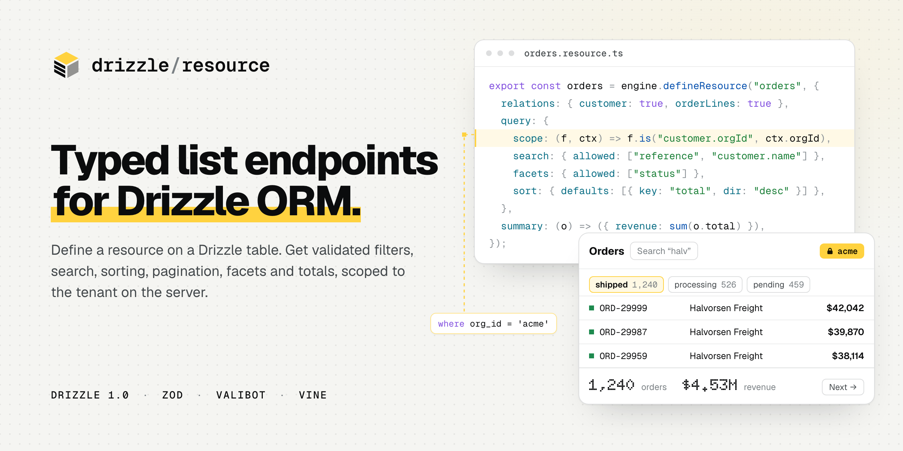

<p align="center">
  <a href="https://drizzle-resource.chronicstone.dev">
    <picture>
      <source media="(prefers-color-scheme: dark)" srcset="https://raw.githubusercontent.com/ChronicStone/drizzle-resource/main/.github/assets/banner-dark.png" />
      
    </picture>
  </a>
</p>

<p align="center">
  <a href="https://npmjs.com/package/drizzle-resource"></a>
  <a href="https://npmjs.com/package/drizzle-resource"></a>
  
  
</p>

<p align="center">
  <a href="https://drizzle-resource.chronicstone.dev/start/quick-start"><b>Quick start</b></a>
  &nbsp;·&nbsp;
  <a href="https://drizzle-resource.chronicstone.dev/playground">Playground</a>
  &nbsp;·&nbsp;
  <a href="https://drizzle-resource.chronicstone.dev/scale/benchmarks">Benchmarks</a>
  &nbsp;·&nbsp;
  <a href="https://drizzle-resource.chronicstone.dev">Docs</a>
</p>

<br />

drizzle-resource builds the list endpoints of an app on top of Drizzle ORM. You define a resource once on a table: which relations it loads, which fields can be filtered, searched, sorted and counted, and the tenant condition every query must carry. Each request is then checked against that definition, turned into SQL, and returned as typed rows with page info, facet counts and totals.

Field paths such as `customer.name` or `orderLines.product.category` are typed from your schema and relations, so a typo is a compile error. The tenant scope comes from your server context, never from the request, so a client cannot remove it.

```sh
bun add drizzle-resource      # or: pnpm add / npm install
```

Requires `drizzle-orm >= 1.0.0-rc.5` with relational queries.

## Define a resource

```ts
import { createQueryEngine } from "drizzle-resource";
import { db } from "./db";
import { relations } from "./relations";
import { schema } from "./schema";

// Once per app. `withContext` declares what your server passes with each request.
export const engine = createQueryEngine({ db, schema, relations }).withContext<{ orgId: string }>();

export const ordersResource = engine.defineResource("orders", {
  relations: {
    customer: true,
    orderLines: { with: { product: true } },
  },
  query: {
    // Added to every statement on the server. The client cannot remove it.
    scope: (f, ctx) => f.is("customer.orgId", ctx.orgId),
    search: {
      allowed: ["reference", "customer.name", "orderLines.product.name"],
      defaults: ["reference", "customer.name"],
    },
    sort: { defaults: [{ key: "createdAt", dir: "desc" }] },
    facets: { allowed: ["status", "customer.name", "orderLines.product.category"] },
    pagination: { modes: ["cursor", "offset"] },
    defaults: { pagination: { mode: "cursor", pageSize: 25 } },
  },
});
```

## Query it

`context` comes from your server, `request` from the client.

```ts
const result = await ordersResource.query({
  context: { orgId: "acme" },
  request: {
    pagination: { mode: "cursor", pageSize: 25 },
    sorting: [{ key: "createdAt", dir: "desc" }],
    search: { value: "laptop", fields: [] }, // [] searches the default fields
    filters: [
      { type: "condition", key: "status", operator: "isAnyOf", value: ["pending", "processing"] },
    ],
    facets: [{ key: "status", mode: "exclude-self", limit: 10 }],
  },
});

result.rows; // typed rows, with customer and orderLines loaded
result.pageInfo; // next cursor, and the exact count when requested
result.facets; // bucket counts per requested facet
```

## Validate the request in your endpoint

The resource generates the schema of the requests it accepts, for Zod, Valibot or Vine. It follows the resource's field rules, defaults and limits, so there is no second contract to keep in sync.

```ts
import { requestSchema } from "drizzle-resource/zod";

const parseOrdersRequest = requestSchema(ordersResource);

app.post("/orders/query", async (c) => {
  const parsed = parseOrdersRequest.safeParse(await c.req.json());
  if (!parsed.success) return c.json({ issues: parsed.error.issues }, 400); // e.g. an unknown field
  return c.json(
    await ordersResource.query({ request: parsed.data, context: { orgId: c.get("orgId") } }),
  );
});
```

## What a request goes through

Every request runs the same stages, in this order:

1. **Validate** every key, operator and field path against the resource. Anything it doesn't allow fails before any SQL runs.
2. **Scope** the query with the tenant condition from your server context.
3. **Count** the matching rows, or compute your own totals with `summary: true`.
4. **Page ids**: filters, search and sorting select the ids of one page, joining only the relations they touch.
5. **Rows**: those ids load the full rows with their relations, in the shape of the view you ask for.
6. **Facets**: bucket counts per value for filter sidebars. Facets that can share a statement do on small tables; above 100,000 estimated rows each facet runs as its own statement, which PostgreSQL can parallelise (`facets.splitAbove`).

Each stage can be replaced with your own implementation through `strategy.*`. [See it run in the playground](https://drizzle-resource.chronicstone.dev/playground), against 10,000 sample orders in your browser.

## Features

- Nested AND / OR filter groups, with the operators that fit each field's type
- Search across the fields and relations you allow
- Several sort keys at once, and fields where sorting is turned off
- Offset or cursor pagination, with an exact count or none
- Facet counts that ignore their own filter, for filter sidebars
- Totals from your own aggregates (`count()`, `sum(...)`), typed from the expression
- Field policy: hide a field, or stop it from being filtered, searched or sorted
- Views: several response shapes from one resource
- Virtual fields: a SQL expression or a correlated subquery, filtered and sorted like a column
- Bulk scans: every matching row in batches from one cursor, for exports and jobs
- Request schemas for Zod, Valibot and Vine, and response schemas for Zod and Valibot

## Benchmarks

Median timings from the repository's PostgreSQL benchmark: 200,000 rows, PostgreSQL 18, one client.

| Request               | 2.4.1 (Sept 2026) | Now      |
| --------------------- | ----------------- | -------- |
| Page, no count        | 39.95 ms          | 0.51 ms  |
| Cursor page, 90% deep | 20.11 ms          | 1.09 ms  |
| Page and exact count  | 62.46 ms          | 4.17 ms  |
| Relation search       | 79.46 ms          | 16.80 ms |
| 3 root facets         | 90.03 ms          | 24.76 ms |
| 5 mixed facets        | 195.04 ms         | 57.38 ms |
| Exclude-self facets   | 138.22 ms         | 35.84 ms |

Single-client engine timings, not HTTP or production latency. [Full results](https://drizzle-resource.chronicstone.dev/scale/benchmarks).

## Methods

| Method                       | Use it when                                                      |
| ---------------------------- | ---------------------------------------------------------------- |
| `resource.query(...)`        | You want a page: ids, rows, and facets or totals if requested.   |
| `resource.findById(...)`     | You need one row by id, with the scope applied.                  |
| `resource.queryIds(...)`     | You only need the ids of a page and its page information.        |
| `resource.queryRows(...)`    | You already have ordered ids and need the rows.                  |
| `resource.queryFacets(...)`  | You need facet counts without the page.                          |
| `resource.querySummary(...)` | You need the totals without the page.                            |
| `resource.scan(...)`         | You need every matching row, in batches, for an export or a job. |

## Contributing

```sh
bun install
bun run ci        # package checks, tests and the docs build
```

Releases use Changesets: add a note with `bun run changeset`. Merging the release PR on `main` publishes to npm.

## License

MIT
